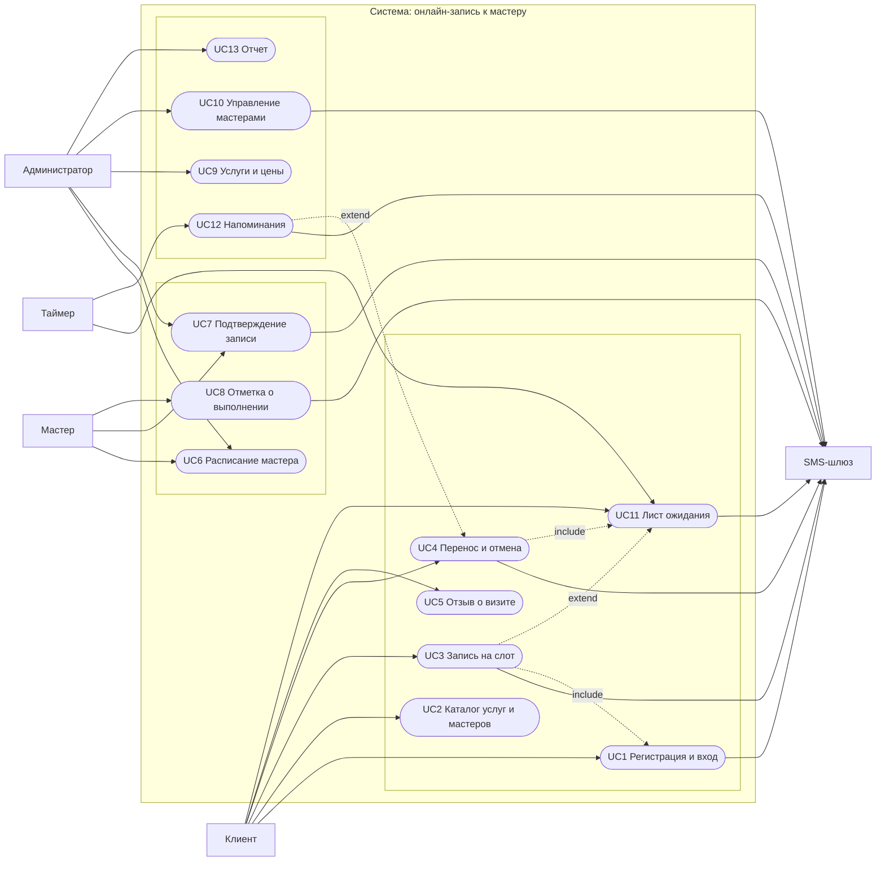

# Use case: "Онлайн-запись к мастеру"

> **Статус: черновик, подготовлен с помощью LLM.** Требует правки и утверждения исполнителями:
> акторы и границы - Пауликайте Елона (Ф3-01), UC1-UC13 - Попова Полина (Ф3-02...Ф3-04),
> диаграмма и сводная таблица - Попова Полина (Ф3-05). Задание разрешает использовать LLM для
> набрасывания use case при условии проверки альтернативных и негативных сценариев.

## 1. Система и ее границы

Веб-приложение (адаптивное под телефон) для записи клиентов к мастерам одного небольшого
салона: парикмахерская, маникюр, автосервис на 3-10 мастеров.

**Входит в систему:** каталог услуг и мастеров, расписание мастеров, запись, перенос и отмена,
подтверждение мастером, лист ожидания, SMS-напоминания, отзывы, отчет администратора.

**Не входит (допущения MVP):**

- онлайн-оплата и касса: оплата на месте, в системе фиксируется только стоимость услуги;
- несколько филиалов и сети салонов;
- склад расходных материалов, зарплата мастеров, бухгалтерия;
- нативные мобильные приложения: только веб;
- программа лояльности и промокоды.

## 2. Акторы

| Актор | Тип | Описание | Как взаимодействует |
|-------|-----|----------|---------------------|
| Клиент | человек | записывается к мастеру, управляет своими записями, оставляет отзывы | веб-интерфейс |
| Мастер | человек | ведет свое расписание, подтверждает записи, отмечает выполнение | веб-интерфейс (личный кабинет) |
| Администратор салона | человек | ведет каталог услуг и мастеров, разбирает конфликты, смотрит отчеты | веб-интерфейс (панель администратора) |
| SMS-шлюз | внешняя система | доставляет SMS: коды входа, уведомления, напоминания | API провайдера (HTTP) |
| Таймер | системное время | запускает напоминания и истечение сроков | внутренний планировщик; в UCP как актор не учитывается |

Общие правила, на которые ссылаются сценарии:

- **П1.** Сетка слотов - 15 минут; длительность услуги кратна 15 минутам.
- **П2.** У клиента одновременно не больше 3 активных (будущих) записей.
- **П3.** Клиент переносит или отменяет запись сам не позднее чем за 2 часа до начала;
  позже - только через администратора.
- **П4.** После 3 неявок клиент получает отметку "ненадежный", и его записи требуют
  подтверждения администратором.
- **П5.** Запись создается со статусом "Ожидает подтверждения", если у мастера включено
  ручное подтверждение, иначе сразу "Подтверждена".

Статусы записи: Ожидает подтверждения -> Подтверждена -> Выполнена | Неявка; из любого
незавершенного статуса возможен переход в Отменена.

## 3. Use case клиента (UC1-UC5)

### UC1. Регистрация и вход клиента

- **Основной актор:** Клиент. **Второстепенный:** SMS-шлюз.
- **Цель:** получить доступ к личному кабинету по номеру телефона без пароля.
- **Предусловие:** нет.
- **Триггер:** клиент нажимает "Войти" или пытается записаться без входа (из UC3).

**Основной сценарий**

1. Клиент вводит номер телефона.
2. Система проверяет формат номера, генерирует 4-значный код со сроком действия 5 минут и
   передает его SMS-шлюзу.
3. SMS-шлюз доставляет код клиенту.
4. Клиент вводит код.
5. Система проверяет код. Номер не найден - запрашивает имя и согласие на обработку
   персональных данных.
6. Клиент вводит имя и подтверждает согласие.
7. Система создает профиль клиента и открывает сессию.

**Альтернативные сценарии**

- **А1 (шаг 5).** Номер уже зарегистрирован: система открывает сессию сразу, шаги 6-7
  пропускаются.
- **А2 (шаг 4).** Клиент запрашивает код повторно не раньше чем через 60 секунд; прежний код
  аннулируется.

**Негативные сценарии**

- **Н1 (шаг 2).** Неверный формат номера: система показывает ошибку, код не отправляется.
- **Н2 (шаг 5).** Код неверный: сообщение об ошибке; после 3 неверных попыток вход по номеру
  блокируется на 15 минут.
- **Н3 (шаг 5).** Код истек: система предлагает получить новый.
- **Н4 (шаг 3).** SMS-шлюз вернул ошибку или недоступен: система сообщает "не удалось
  отправить код, повторите позже" и записывает событие в журнал.
- **Н5 (шаг 6).** Клиент не подтвердил согласие: профиль не создается.

**Постусловие:** клиент авторизован; новый клиент сохранен в системе.

### UC2. Просмотр каталога услуг и мастеров

- **Основной актор:** Клиент (в том числе не вошедший).
- **Цель:** выбрать услугу и мастера.
- **Предусловие:** нет.
- **Триггер:** клиент открывает главную страницу.

**Основной сценарий**

1. Клиент открывает каталог.
2. Система показывает категории и опубликованные услуги: название, длительность, цена,
   мастера, которые ее оказывают.
3. Клиент выбирает категорию или вводит поиск по названию.
4. Система показывает отфильтрованный список.
5. Клиент открывает карточку услуги.
6. Система показывает описание, цену, длительность и мастеров с их средней оценкой и числом
   отзывов.

**Альтернативные сценарии**

- **А1 (шаг 3).** Клиент переключается на вкладку "Мастера" и открывает карточку мастера:
  система показывает его услуги, оценку и последние отзывы.
- **А2 (шаг 6).** Клиент нажимает "Записаться": переход в UC3 с выбранной услугой и мастером.

**Негативные сценарии**

- **Н1 (шаг 4).** По фильтру ничего не найдено: система показывает "услуги не найдены" и
  предлагает сбросить фильтр.
- **Н2 (шаг 5).** Услуга снята с публикации, пока клиент смотрел список: система сообщает, что
  услуга недоступна, и обновляет список.

**Постусловие:** состояние системы не меняется.

### UC3. Запись к мастеру на свободный слот

- **Основной актор:** Клиент. **Второстепенные:** Мастер (получает уведомление), SMS-шлюз.
- **Цель:** забронировать время у мастера.
- **Предусловие:** клиент авторизован (иначе UC1).
- **Триггер:** клиент нажимает "Записаться".

**Основной сценарий**

1. Клиент выбирает услугу и мастера.
2. Система показывает календарь на 30 дней вперед с днями, где есть свободное время.
3. Клиент выбирает день.
4. Система рассчитывает свободные слоты: рабочие интервалы мастера (UC6) минус существующие
   записи, с учетом длительности услуги (П1), и показывает их.
5. Клиент выбирает слот и подтверждает запись, при желании добавив комментарий.
6. Система повторно проверяет, что слот свободен, и правило П2, создает запись со статусом по
   П5, уведомляет мастера в личном кабинете и отправляет клиенту SMS с деталями через шлюз.
7. Система показывает клиенту экран "Вы записаны" с возможностью перенести или отменить.

**Альтернативные сценарии**

- **А1 (шаг 1).** Клиент выбирает "любой мастер": на шаге 4 система объединяет слоты всех
  мастеров, оказывающих услугу, а на шаге 6 назначает мастера с наименьшей загрузкой в этот
  день.
- **А2 (шаг 1).** Клиент не авторизован: выполняется UC1, затем возврат к шагу 2 с сохранением
  выбора.
- **А3 (шаг 4).** Свободных слотов в выбранный день нет: система предлагает ближайшие дни со
  свободным временем или встать в лист ожидания (UC11).

**Негативные сценарии**

- **Н1 (шаг 6).** Слот занят другим клиентом между шагами 4 и 6: система сообщает об этом и
  показывает обновленный список слотов.
- **Н2 (шаг 6).** У клиента уже 3 активные записи (П2): запись не создается, система
  предлагает перейти в "Мои записи".
- **Н3 (шаг 6).** Клиент отмечен "ненадежным" (П4): запись создается со статусом "Ожидает
  подтверждения" администратором независимо от настроек мастера.
- **Н4 (шаг 6).** SMS не отправлено: запись сохраняется, ошибка пишется в журнал, клиент видит
  детали на экране.

**Постусловие:** запись создана, слот занят, мастер уведомлен.

### UC4. Перенос и отмена записи

- **Основной актор:** Клиент. **Второстепенные:** Мастер, SMS-шлюз.
- **Цель:** изменить время записи или отказаться от нее.
- **Предусловие:** клиент авторизован, у него есть будущая запись.
- **Триггер:** клиент открывает "Мои записи" или переходит по ссылке из SMS (UC12).

**Основной сценарий (отмена)**

1. Клиент открывает "Мои записи" и выбирает запись.
2. Система показывает детали и действия "Перенести" и "Отменить".
3. Клиент выбирает "Отменить" и указывает причину (необязательно).
4. Система проверяет правило П3, переводит запись в статус "Отменена", освобождает слот,
   уведомляет мастера и запускает обработку листа ожидания по этому слоту (UC11).
5. Система отправляет клиенту SMS-подтверждение отмены.

**Альтернативные сценарии**

- **А1 (шаг 3). Перенос.** Клиент выбирает "Перенести": система показывает свободные слоты того
  же мастера (как в UC3, шаги 2-4), клиент выбирает новый слот; система в одной операции
  занимает новый слот, освобождает старый, сбрасывает статус по П5 и уведомляет мастера и
  клиента.

**Негативные сценарии**

- **Н1 (шаг 4).** До начала меньше 2 часов (П3): самостоятельное изменение запрещено, система
  показывает телефон салона.
- **Н2 (А1).** Новый слот занят до подтверждения: система сообщает и предлагает выбрать
  другой; старая запись остается без изменений.
- **Н3 (шаг 2).** Запись уже выполнена, отменена или отмечена неявкой: действия недоступны.

**Постусловие:** запись отменена или перенесена, освободившийся слот доступен другим.

### UC5. Отзыв о визите

- **Основной актор:** Клиент. **Второстепенный:** Администратор (скрывает недопустимые
  отзывы).
- **Цель:** оценить мастера после визита.
- **Предусловие:** по записи клиента есть отметка "Выполнена" (UC8).
- **Триггер:** клиент переходит по ссылке из SMS после визита или открывает выполненную запись.

**Основной сценарий**

1. Клиент открывает форму отзыва по выполненной записи.
2. Система показывает услугу, мастера и дату визита.
3. Клиент ставит оценку от 1 до 5 и пишет текст до 1000 символов.
4. Система сохраняет отзыв, пересчитывает среднюю оценку мастера и показывает отзыв в
   карточке мастера.

**Альтернативные сценарии**

- **А1 (шаг 3).** Клиент ставит только оценку без текста: отзыв сохраняется, в списке
  отзывов показывается только оценка.
- **А2 (шаг 4).** Клиент редактирует свой отзыв в течение 7 дней после публикации.
- **А3 (после шага 4).** Администратор скрывает отзыв с оскорблениями или рекламой: отзыв не
  виден и не участвует в средней оценке, клиент получает уведомление.

**Негативные сценарии**

- **Н1 (шаг 1).** По записи уже есть отзыв: система предлагает редактирование (А2) или
  сообщает, что срок истек.
- **Н2 (шаг 1).** Запись не выполнена (отменена, неявка): форма недоступна.
- **Н3 (шаг 3).** Нет оценки или текст длиннее 1000 символов: система не сохраняет отзыв и
  подсвечивает ошибку.

**Постусловие:** отзыв сохранен, рейтинг мастера пересчитан.

## 4. Use case мастера (UC6-UC8)

### UC6. Ведение расписания мастера

- **Основной актор:** Мастер. **Второстепенный:** Администратор (может вести расписание за
  мастера).
- **Цель:** задать рабочее время, из которого строятся свободные слоты.
- **Предусловие:** мастер авторизован в личном кабинете.
- **Триггер:** мастер открывает "Мое расписание".

**Основной сценарий**

1. Мастер открывает недельный шаблон расписания.
2. Система показывает рабочие интервалы по дням недели и перерывы.
3. Мастер задает рабочие интервалы и перерывы по дням недели.
4. Система проверяет интервалы (кратность 15 минутам, отсутствие пересечений), сохраняет
   шаблон и пересчитывает свободные слоты на 30 дней вперед.

**Альтернативные сценарии**

- **А1 (шаг 3).** Мастер добавляет исключение на конкретную дату или период: выходной, отпуск,
  измененные часы. Исключение имеет приоритет над шаблоном.
- **А2 (шаг 3).** Расписание ведет администратор за мастера, далее те же шаги.

**Негативные сценарии**

- **Н1 (шаг 4).** Интервалы пересекаются или не кратны 15 минутам: сохранение отклоняется с
  указанием ошибки.
- **Н2 (шаг 4).** Изменение затрагивает существующие записи: система показывает список
  конфликтующих записей; мастер либо отменяет изменение, либо сохраняет его, и тогда
  конфликтные записи передаются администратору для переноса с уведомлением клиентов.

**Постусловие:** расписание сохранено, свободные слоты пересчитаны.

### UC7. Подтверждение записи мастером

- **Основной актор:** Мастер. **Второстепенные:** SMS-шлюз, Администратор.
- **Цель:** подтвердить, что мастер примет клиента.
- **Предусловие:** есть запись в статусе "Ожидает подтверждения" (П5).
- **Триггер:** мастер получает уведомление о новой записи.

**Основной сценарий**

1. Мастер открывает список записей, ожидающих подтверждения.
2. Система показывает записи: клиент, услуга, время, комментарий клиента.
3. Мастер подтверждает запись.
4. Система переводит запись в статус "Подтверждена" и отправляет клиенту SMS.

**Альтернативные сценарии**

- **А1 (шаг 3).** Мастер отклоняет запись с указанием причины: система переводит ее в
  "Отменена", освобождает слот и отправляет клиенту SMS с причиной и ссылкой на запись к
  другому времени или мастеру.
- **А2 (по таймеру).** Запись не подтверждена за 12 часов или за 3 часа до начала: система
  передает ее администратору, который подтверждает или отклоняет ее вместо мастера.

**Негативные сценарии**

- **Н1 (шаг 3).** Клиент успел отменить запись: система сообщает, что запись уже отменена, и
  обновляет список.
- **Н2 (шаг 4).** SMS не доставлено: статус сохраняется, ошибка пишется в журнал.

**Постусловие:** запись подтверждена или отклонена, клиент уведомлен.

### UC8. Отметка о выполнении услуги

- **Основной актор:** Мастер. **Второстепенный:** SMS-шлюз.
- **Цель:** зафиксировать факт и стоимость оказанной услуги.
- **Предусловие:** время начала подтвержденной записи наступило.
- **Триггер:** мастер завершает работу с клиентом.

**Основной сценарий**

1. Мастер открывает записи на сегодня.
2. Система показывает записи, у которых наступило время начала.
3. Мастер отмечает запись как "Выполнена" и при необходимости меняет итоговую стоимость.
4. Система сохраняет статус и фактическую стоимость (для отчета UC13) и через 2 часа
   отправляет клиенту SMS со ссылкой на отзыв (UC5).

**Альтернативные сценарии**

- **А1 (шаг 3).** Клиент не пришел: мастер отмечает "Неявка", система увеличивает у клиента
  счетчик неявок и при достижении 3 ставит отметку "ненадежный" (П4).
- **А2 (шаг 3).** Оказана дополнительная услуга: мастер добавляет ее из каталога, стоимость
  пересчитывается.

**Негативные сценарии**

- **Н1 (шаг 3).** Время начала еще не наступило: отметка недоступна.
- **Н2 (шаг 3).** Запись уже отмечена: повторная отметка невозможна, исправить ее может
  только администратор.

**Постусловие:** запись в статусе "Выполнена" или "Неявка", стоимость зафиксирована.

## 5. Use case администратора и системы (UC9-UC13)

### UC9. Управление услугами и ценами

- **Основной актор:** Администратор.
- **Цель:** поддерживать актуальный каталог.
- **Предусловие:** администратор авторизован.
- **Триггер:** администратор открывает раздел "Услуги".

**Основной сценарий**

1. Администратор нажимает "Добавить услугу".
2. Система показывает форму: название, категория, описание, длительность, цена, мастера.
3. Администратор заполняет форму и сохраняет.
4. Система проверяет данные и публикует услугу в каталоге.

**Альтернативные сценарии**

- **А1 (шаг 1).** Администратор редактирует услугу: новая цена и длительность действуют для
  новых записей, существующие записи не меняются.
- **А2 (шаг 1).** Администратор снимает услугу с публикации: в каталоге она не видна,
  существующие записи сохраняются.

**Негативные сценарии**

- **Н1 (шаг 4).** Услуга с таким названием в категории уже есть: сохранение отклоняется.
- **Н2 (шаг 4).** Длительность не кратна 15 минутам (П1), цена не положительная или не выбран
  ни один мастер: сохранение отклоняется с подсветкой полей.
- **Н3 (А2).** Попытка удалить услугу, по которой есть будущие записи: удаление запрещено,
  доступно только снятие с публикации.

**Постусловие:** каталог обновлен.

### UC10. Управление мастерами

- **Основной актор:** Администратор. **Второстепенный:** SMS-шлюз.
- **Цель:** вести состав мастеров и их доступ в систему.
- **Предусловие:** администратор авторизован.
- **Триггер:** администратор открывает раздел "Мастера".

**Основной сценарий**

1. Администратор нажимает "Добавить мастера".
2. Система показывает форму: имя, телефон, фото, описание, оказываемые услуги, режим
   подтверждения записей (П5).
3. Администратор заполняет форму и сохраняет.
4. Система создает учетную запись мастера и отправляет ему SMS с приглашением войти в
   личный кабинет.

**Альтернативные сценарии**

- **А1 (шаг 1).** Администратор редактирует данные мастера или набор его услуг.
- **А2 (шаг 1).** Администратор деактивирует мастера: мастер пропадает из каталога, вход в
  личный кабинет закрывается.

**Негативные сценарии**

- **Н1 (шаг 4).** Телефон уже используется другим мастером или администратором: сохранение
  отклоняется.
- **Н2 (А2).** У мастера есть будущие записи: система показывает их список; администратор
  переносит их к другим мастерам или отменяет с уведомлением клиентов, только после этого
  деактивация выполняется.

**Постусловие:** состав мастеров обновлен.

### UC11. Лист ожидания

- **Основные акторы:** Клиент, Таймер. **Второстепенный:** SMS-шлюз.
- **Цель:** получить запись, если желаемое время освободится.
- **Предусловие:** клиент авторизован, на выбранную дату нет подходящих слотов (UC3, А3).
- **Триггер:** клиент нажимает "Встать в лист ожидания".

**Основной сценарий**

1. Клиент указывает услугу, мастера (или "любой"), дату и желаемый интервал времени.
2. Система сохраняет заявку в очередь по этой дате и мастеру.
3. Когда подходящий слот освобождается (UC4, UC7 А1), система выбирает первую по времени
   заявку, резервирует слот на 30 минут и отправляет клиенту SMS со ссылкой.
4. Клиент переходит по ссылке и подтверждает запись.
5. Система создает запись (как в UC3, шаг 6) и закрывает заявку.

**Альтернативные сценарии**

- **А1 (шаг 4).** Клиент отказался или не ответил за 30 минут: резерв снимается, слот
  предлагается следующей заявке в очереди.
- **А2 (в любой момент).** Клиент отменяет заявку в "Моих записях".

**Негативные сценарии**

- **Н1 (шаг 1).** У клиента уже 3 активные заявки в листе ожидания: новая не создается.
- **Н2 (по таймеру).** Дата заявки прошла: система закрывает заявку и уведомляет клиента.
- **Н3 (шаг 5).** У клиента к этому моменту уже 3 активные записи (П2): запись не создается,
  слот переходит следующей заявке.

**Постусловие:** клиент записан, или заявка закрыта.

### UC12. Напоминания о записи

- **Основной актор:** Таймер. **Второстепенные:** SMS-шлюз, Клиент.
- **Цель:** снизить число неявок.
- **Предусловие:** есть подтвержденная запись.
- **Триггер:** до начала записи остается 24 часа, затем 2 часа.

**Основной сценарий**

1. Планировщик раз в 5 минут выбирает подтвержденные записи, по которым подошло время
   напоминания.
2. Система формирует текст: услуга, мастер, адрес, время и ссылки "Подтверждаю" и
   "Отменить".
3. Система передает SMS шлюзу и отмечает напоминание как отправленное.
4. Клиент получает SMS.

**Альтернативные сценарии**

- **А1 (шаг 4).** Клиент переходит по ссылке "Отменить": выполняется UC4.
- **А2 (шаг 4).** Клиент переходит по ссылке "Подтверждаю": система отмечает, что клиент
  подтвердил визит; мастер видит отметку.

**Негативные сценарии**

- **Н1 (шаг 3).** Шлюз вернул ошибку: до 3 повторов с интервалом 10 минут, затем запись в
  журнал и показ записи администратору как "без напоминания".
- **Н2 (шаг 1).** Клиент отключил напоминания в профиле: SMS не отправляется.
- **Н3 (шаг 1).** Запись создана меньше чем за 24 часа: первое напоминание пропускается,
  отправляется только второе.

**Постусловие:** напоминание отправлено или ошибка зафиксирована.

### UC13. Отчет по загрузке и выручке

- **Основной актор:** Администратор.
- **Цель:** оценить загрузку мастеров и выручку салона.
- **Предусловие:** администратор авторизован.
- **Триггер:** администратор открывает раздел "Отчеты".

**Основной сценарий**

1. Администратор выбирает период и при желании мастера.
2. Система рассчитывает по каждому мастеру: число записей, выполненных визитов, отмен и
   неявок; загрузку (занятые минуты / рабочие минуты по расписанию, %); выручку по
   фактической стоимости (UC8).
3. Система показывает таблицу и итоги по салону.

**Альтернативные сценарии**

- **А1 (шаг 3).** Администратор выгружает отчет в xlsx.
- **А2 (шаг 3).** Администратор открывает детализацию по мастеру: список записей за период.

**Негативные сценарии**

- **Н1 (шаг 2).** За период нет данных: система показывает пустой отчет с пояснением.
- **Н2 (шаг 1).** Период длиннее 12 месяцев или дата начала позже даты окончания: система
  просит изменить период.

**Постусловие:** состояние системы не меняется.

## 6. Диаграмма use case

Сплошные стрелки - участие актора в UC, пунктир - отношения include и extend между UC.

## 7. Сводная таблица

Колонки А и Н - число альтернативных и негативных сценариев. Транзакции для UCP (Ф3-08)
считает Полина по этому документу.

| UC | Название | Основной актор | Второстепенные | А | Н |
|----|----------|----------------|----------------|---|---|
| UC1 | Регистрация и вход клиента | Клиент | SMS-шлюз | 2 | 5 |
| UC2 | Просмотр каталога услуг и мастеров | Клиент | - | 2 | 2 |
| UC3 | Запись к мастеру на свободный слот | Клиент | Мастер, SMS-шлюз | 3 | 4 |
| UC4 | Перенос и отмена записи | Клиент | Мастер, SMS-шлюз | 1 | 3 |
| UC5 | Отзыв о визите | Клиент | Администратор | 3 | 3 |
| UC6 | Ведение расписания мастера | Мастер | Администратор | 2 | 2 |
| UC7 | Подтверждение записи мастером | Мастер | SMS-шлюз, Администратор | 2 | 2 |
| UC8 | Отметка о выполнении услуги | Мастер | SMS-шлюз | 2 | 2 |
| UC9 | Управление услугами и ценами | Администратор | - | 2 | 3 |
| UC10 | Управление мастерами | Администратор | SMS-шлюз | 2 | 2 |
| UC11 | Лист ожидания | Клиент, Таймер | SMS-шлюз | 2 | 3 |
| UC12 | Напоминания о записи | Таймер | SMS-шлюз, Клиент | 2 | 3 |
| UC13 | Отчет по загрузке и выручке | Администратор | - | 2 | 2 |
| | **Итого** | | | **27** | **36** |

## 8. Открытые вопросы для команды

1. Подтверждает ли мастер каждую запись (П5) или по умолчанию запись подтверждается
   автоматически? От этого зависит вес UC7.
2. Нужна ли в MVP запись на несколько услуг подряд в одном визите? Сейчас не включена: одна
   запись - одна услуга (дополнительная услуга добавляется только мастером в UC8).
3. Кандидаты на отказ при нехватке ресурсов (для Ф3-12): UC11 "Лист ожидания" (сложная
   логика очереди и резервов), UC5 "Отзывы" (модерация), выгрузка отчета в xlsx (UC13 А1).
